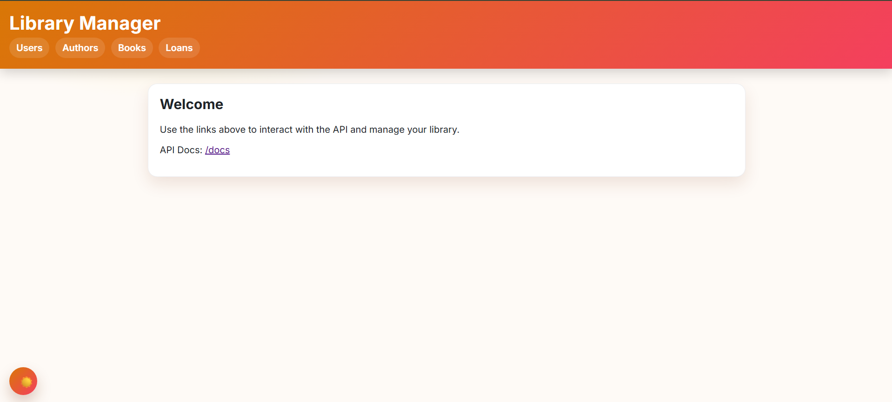

# Library manager

Books, authors, and loans. FastAPI stores them, the pages under `web/` call the same server.

## Run

```bash
python -m venv .venv
.venv\Scripts\activate
pip install -r requirements.txt
cp .env.example .env
uvicorn src.api.main:app --reload --host 0.0.0.0 --port 9000
```

On macOS or Linux, `source .venv/bin/activate`.

UI: http://localhost:9000/ui
Docs: http://localhost:9000/docs
Health: http://localhost:9000/health



Borrow only works if a copy is free. Return marks the loan and puts the copy back, not above `copies_total`. Login returns a JWT. The UI sends it as `Authorization: Bearer ...`. Schema changes are Alembic migrations in `alembic/versions`.

## Layout

```
src/api/   app, models, routers, services
web/       html and ui.js
alembic/   migrations
tests/
```

If `/docs` stays on Loading, install `python-multipart`. If localhost hangs on Windows, keep `--host 0.0.0.0 --port 9000`. CSS not updating is usually cache. Ctrl+F5.
